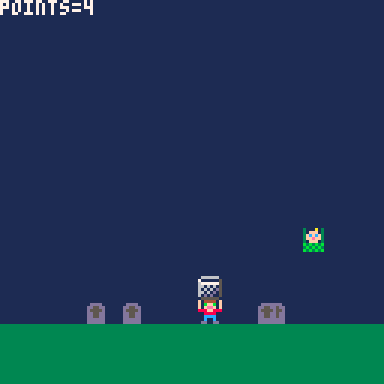
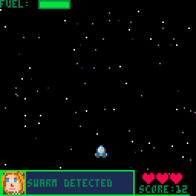
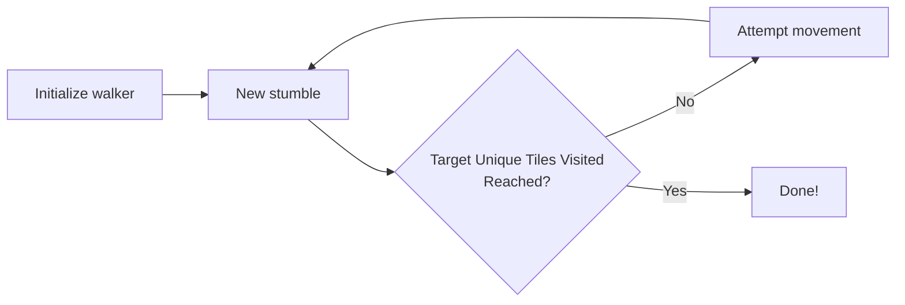
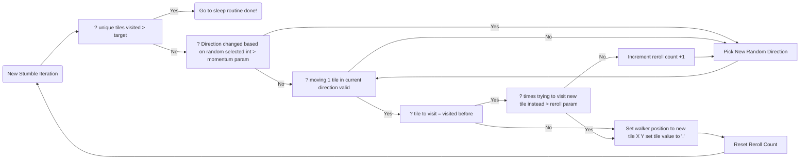

+++
draft = true
title = "Postmortem: Drunkards Walk Proc Gen"
date = "2026-11-02T22:13:44-06:00"
#dateFormat = "2006-01-02" # This value can be configured for per-post date formatting
author = ""
authorTwitter = "" #do not include @
cover = ""
tags = ["", ""]
keywords = ["", ""]
description = ""
showFullContent = false
readingTime = false
hideComments = false
+++

## Drunkard's Walk Algorithm

This project is the first pay off from a handful of game dev bets I'm making.
- I can get more exposure by making parts of games than whole games.
- I can get a larger amount of meaningful work done by focusing on parts of games.
- Posting in targeted communities instead of the open web will yield better results.
- Using a programming language over an engine will lead to a more useful system. 
- Using golang to blaze a trail is more valuable than doing whats been done a million times in python and c

Game dev has become a hobby of mine over the past year. It's fun to show my friends what I'm working on and flex my creative & analytical muscles at the same time. I'd prefer to do this over my day job and become a gazillionaire like notch but I'm not as talented, handsome, and my day job keeps me pretty busy.

Building games takes time. Enormous amounts of time. I remember starting because a youtube video told me it would be easy to make a small game with pico-8. I also saw youtube videos telling me I should focus on small games not my dream game. A dream game takes years, a small game takes...the youtube videos did not tell me how long a small game takes. I'll tell you how long.

Following a tutorial for a small game may take you as little as an afternoon. That's likely a pretty boring game. I recently completed a course on remaking asteroids. 77 videos to follow. That took me roughly a month. That's just following along and not doing your own thing along the way. If you want to make the content your own while following along with a series of this length, double your time investment. Where am I getting double the time from? That's roughly my expereince from turning nerdy teachers "fruit drop" into baby drop and creating a shmup.

Baby drop took about a week, making the art, learning lua, learning pico-8's special lua commands, learning pico-8's command line, tuning the animation of the birds, fixing bugs.

I told a crowd about this game at a big indie game dev meeting and was booed by maybe 20 people out of like 50 in the audience. People don't like dropping babies, but at least they felt something. My in laws who do not like video games did not appreciate the artistic merit of this project either. History will vindicate me.

I also completed most of lazy dev's shmup intro series and put a lot of extra work into my version of the animations, game loop, and code archicture. This added an extra month of work.

Looking back the greatest innovation was making the ship pilot say "bastard". See how the text box smoothly slides open before printing the curse word? Two afternoons of fighting. One stranger on reddit complemented me though... so it's all worth it.

Checking in with you dear reader. We are pretty far in and I haven't gotten to anything about drunk walks or even completed my first point. We are getting there. 

The important issue to understand with point one is that game dev is an intense time investment, and by the end you don't really know what you are going get. 4k views on reddit and five comments on your post, a crowd booing you- after potentially months of work. This is after following the trendy advice new indie game devs should "focus on small games". Can we do better than that? Maybe.

After I don't know how much time scrolling I stumbled on an idea from another youtube account- don't focus on building games, build parts of games that can be used to make a game later. 



I didn't like this at first but I've been warming up to it. The idea is simple, if you focus on a system like say procedural generation, or walk animations, you will finish faster than making an entire game and you will have something to share faster and keep back on faster. This may allow you to find something that catches on faster. I'm following advice from a college kid and I'm 35 by the way. This journey is pretty damn humbling.

## Point 1 & 2
So exposure. That's a goal of mine. My drunk walk animation took about 2 weeks to make which is really fast for me by the way. I have an 8 month son so my game development happens in pockets- it's like a guilty pleasure I get to sneak in. Like smoking ciggerettes outside the office with the aircraft dispatch crew on break and not telling anyone even though I've been quit from smoking ciggerettes for 15 years. Two weeks dear reader, 17k views on reddit. Thats a usable start, an amount of attention I can try and do something with- I have plans. That's the last unproven part, point five. The project before that, a fire animation that took two weeks, got zero views. Same with my terminal rain animation. But these were short rapid projects and now I've found a great lead for a type of content that resonates. A wonderful turn of phrase applies here. Fuck around and find out. The more you fuck around, the more you find out. Building systems instead of games allows you fuck around more, so you find out more.

## Point 3
Points one and two down, now you want to know about targeted posting. Posting on youtube is like yelling into the void and hoping the void speaks back, same with posting blindly on instagram or any other platform where you hope the algothrymn will lift you up and make you famous. It's probabbly not going to happen. But posting in a community, in an engaging way, about something relavent to that community... that sounds way better right? I've made maybe 5 youtube videos. The most views I've recieved on that mega platform is around 250 views. That's not an amount of attention I can do anything with. Instagram has given me around 600 views in one go. You get no community to piggy back off of, you have to build your following slowly and that generates your views. 

The same drunk walk gif that generated 17k views on reddit generated exactly 0 views on youtube. Ouch.

## Point 4.
My systems for procedural generation are more and more complex yet it's roughly the same difficulty to manage as day one- when it should be much harder. 
That's because as I go, I can reuse more and more of my work. I'm not just building a drunk walk system- drunk walk is part one of a procedural generation library and my procedural generation library is merely part one of my tile based game development library. Game engines dont allow you to build game building systems- they allow you to build games. My systems can plug into more than one engine, target any platform, they even target different programming languages. Some of that is based picking on golang, either way I'm not locked into one engine's walled garden.

# Point 5. 
This is not proven, but I'm working towards it. golang is an under utilized tool for game development. For me it's a nice blend between the ease of an interpretted language and the control of a complied language. Perhaps it will never catch on. For people want to program on easy street, lua will always be simplier, many engines support it and love2d is very mature. People who want the abosulte best performance will always go with c or maybe rust some day- golang is garbage collected will always carry that overhead- but for the indie dev with little time who wants to ship one binary that can run anywhere, there is one established game in town- and it's not popular for gamedev. That's an opportunity and a curse. When I make a proc generation algorythmn, I may be one of the first to share my work on that algo in golang. I see that as an opportunity, which is why I am collecting these algothrymns into a library for procedural generation in golang- Bodleian. Not a mishmash of disconnected proc gen expiriments, but a consitient syntax for generating tile maps from the greatest hits of proc gen- delivred in data structure(a 2d array of strings) that allow easy post processing and use in any kind of application. 

## Drunk Walk In A Nutshell

Whew, now that you know my life story, my hopes, dreams, and vision for the future we can talk about the most basic level generation algo in existence.

What about the drunk walk? That's pretty simple. Imagine a cave with a drunk giant stumbling around, he can hulk smash through all the rocks but he is drunk so he does so randomly. let him walk around until he goes to sleep for the night. What's left is a cave system. The problem is that it often produces blobs and when should the giant stop walking? Let the giant stumble around in a while loop until x percent of spaces are visited. So the latter problem is solved, what about blobyness? I gave the giant a momentum parameter. the higher the momentum the more our giant prefers to continue in the same direction, meaning we get coordidoors and blobs... depeding on how high we set momentum! It is also possible to get mostly cooridors if we set momentum high enough.

Clear as mud? Here is the high level proccess.

And here is a very detailed view into the process which may benefit from pressing "command/ctrl +"

Honestly wolverson does a much better job explaining than I do. Check him out!



### Just show me the code!
https://github.com/PigsEyedea/drunkardwalk/tree/main

A note about my code vs wolverson's. Part of my blobyness solve is contraining the drunkard to only walking on spaces they havent visted then softening that constraint by making them try to visit a visted space x times before being allowed to visit the space.
