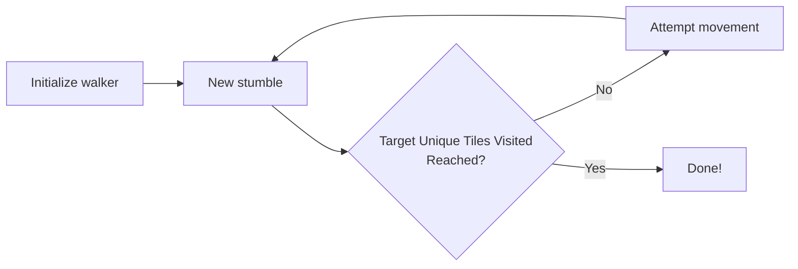
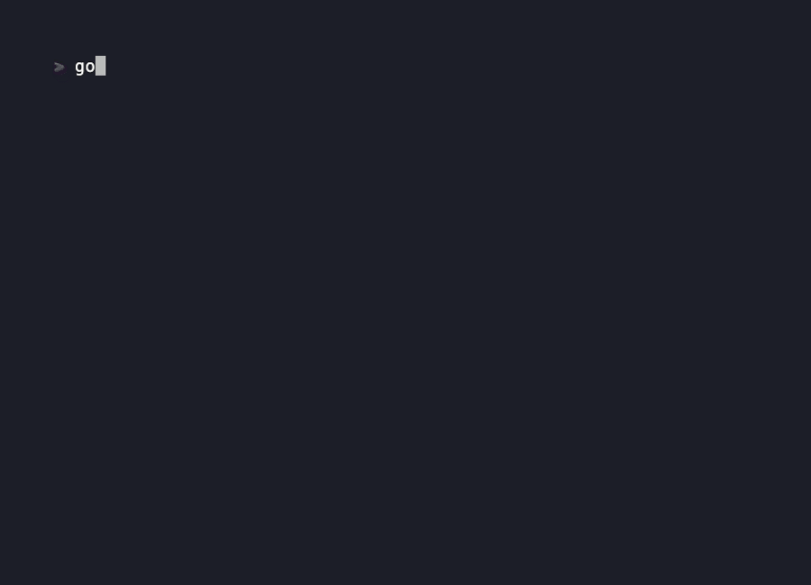
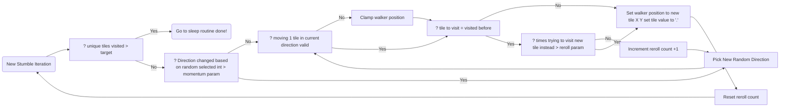

+++
draft = true
title = "Postmortem: a little Drunkard's Walk Proc Gen And a lot of Indie Dev Manifesto"
date = "2026-11-02T22:13:44-06:00"
#dateFormat = "2006-01-02" # This value can be configured for per-post date formatting
author = ""
authorTwitter = "" #do not include @
cover = "rwProcGen.gif"
tags = ["Golang", "Proc Gen", "Game Dev","Rant"]
keywords = ["", ""]
description = ""
showFullContent = false
readingTime = false
hideComments = false
+++

## Five Solo Dev Bets

This project is the first pay off from a handful of game dev bets I'm making.
1. I can get more exposure by making parts of games than whole games.
2. I can get a larger amount of meaningful work done by focusing on parts of games.
3. Posting in targeted communities instead of the open web will yield better results.
4. Using a programming language over an engine will lead to a more useful system. 
5. Using golang to blaze a trail is more valuable than doing what's been done a million times in python and c

Game dev has become a hobby of mine over the past year. It's fun to show my friends what I'm working on and flex my creative & analytical muscles at the same time. I'd prefer to do this over my day job and become a gazillionaire like Notch but I'm not as talented or handsome, and my day job keeps me pretty busy.


Building games takes time. Enormous amounts of time. I remember starting because a youtube video told me it would be easy to make a small game with pico-8. I also saw youtube videos telling me I should focus on small games, not my dream game. A dream game takes years, a small game takes...the youtube videos did not tell me how long a small game takes. I'll tell you how long.

Following a tutorial for a small game may take you as little as an afternoon. That's likely a pretty boring game. I recently completed a course on remaking asteroids. 77 videos to follow. That took me roughly a month. That's just following along and not doing your own thing along the way. If you want to make the content your own while following along with a series of this length, double your time investment. Where am I getting double the time from? That's roughly my experience from turning nerdy teachers' "fruit drop" into baby drop and creating a shmup.


Baby drop took about a week, making the art, learning Lua, learning pico-8's special Lua commands, learning pico-8's command line, tuning the animation of the birds, fixing bugs.


I told a crowd about this game at a big indie game dev meeting and was booed by maybe 20 people out of like 50 in the audience. People don't like dropping babies, but at least they felt something. My in-laws who do not like video games did not appreciate the artistic merit of this project either. History will vindicate me.

I also completed most of lazy dev's shmup intro series and put a lot of extra work into my version of the animations, game loop, and code architecture. This added an extra month of work.


Looking back the greatest innovation was making the ship pilot say "bastard". See how the text box smoothly slides open before printing the curse word? Two afternoons of fighting. One stranger on reddit complimented me though... so it's all worth it.

Checking in with you, dear reader. We are pretty far in and I haven't gotten to anything about drunk walks or even completed my first point. We are getting there. 

The important issue to understand with point one is that game dev is an intense time investment, and by the end you don't really know what you are going get. 4k views on reddit and five comments on your post, a crowd booing you- after potentially months of work. This is after following the trendy advice that new indie game devs should "focus on small games". Can we do better than that? Maybe.

After I don't know how much time scrolling I stumbled on an idea from another youtube account- don't focus on building games, build parts of games that can be used to make a game later. 



I didn't like this at first but I've been warming up to it. The idea is simple, if you focus on a system like say procedural generation, or walk animations, you will finish faster than making an entire game and you will have something to share faster and keep back on faster. This may allow you to find something that catches on faster. I'm following advice from a college kid and I'm 35 by the way. This journey is pretty damn humbling.

## Points 1 & 2: Exposure & Dev Time Efficiency 
So exposure. That's a goal of mine. My drunk walk animation took about 2 weeks to make which is really fast for me by the way. I have an 8 month old son so my game development happens in pockets- it's like a guilty pleasure I get to sneak in. Like smoking cigarettes outside the office with the aircraft dispatch crew on break and not telling my wife even though I've been off the ciggies for like 15 year now. Two weeks dear reader, 17k views on reddit. Thats a usable start, an amount of attention I can try and do something with- I have plans. That's the last unproven part, point five. The project before that, a fire animation that took two weeks, got zero views. Same with my terminal rain animation. But these were short rapid projects and now I've found a great lead for a type of content that resonates. A wonderful turn of phrase applies here. Fuck around and find out. The more you fuck around, the more you find out. Building systems instead of games allows you fuck around more, so you find out more.

I guess you could call this applying agile to indie dev. As a corporate cog I like that. Build the thing in little pieces that have value by themself. 

## Point 3: Don't shout into the void
Posting on youtube is like yelling into the void and hoping the void speaks back, same with posting blindly on instagram or any other platform where you hope the algorithms will lift you up and make you famous. It's probably not going to happen. Now imagine posting in a community, in an engaging way, about something relevant to that community... that sounds way better right? I've made maybe 5 youtube videos. The most views I've received on that mega platform is around 250 views. That's not an amount of attention I can do anything with. Instagram has given me around 600 views in one go. You get no community to piggy back off of, you have to build your following slowly and that generates your views. 

The same drunk walk gif that generated 17k views on reddit generated exactly 0 views on youtube. Ouch.

## Point 4: Reuse matters, ditch the engine [^engines]

My systems for procedural generation are more and more complex yet it's roughly the same difficulty to manage as day one- when it should be much harder. 
That's because as I go, I can reuse more and more of my work. I'm not just building a drunk walk system- drunk walk is part one of a procedural generation library and my procedural generation library is merely part one of my tile based game development library. Big game engines like Unity and Godot stifle system development by locking you into their engine solving problems their engine's way. My systems can plug into more than one engine, target any platform, they even target different programming languages. Some of that is based picking on golang, either way I'm not locked into one engine's walled garden.

| Skill / Activity | Engine | Language |
|---|:---:|:---:|
| Learn coding | Yes | Yes |
| Learn proprietary UI | Yes | No |
| Develop engine-specific workflows | Yes | No |
| Develop system-agnostic workflows | No | Yes |
| Gain marketable skills | Possible | Certain |

Even worse the opportunity cost from developing a skill like GDscript in Godot when you could learn a programming language with significant labor market demand.

[^engines]: I'm talking about big engines like Unity, Unreal, and Godot- not engines like Raylib, SDL2, Ebiten, Love2D, etc . ect. At some point you want to embrace a sane abstraction layer. I draw line at programming language first engines vs UI heavy engines with huge UI component ecosystems.


## Point 5: Golang, a compelling balance of trade offs
This is not proven, but I'm working towards it. Golang is an under utilized tool for game development. For me it's a nice blend between the ease of an interpreted language and the control of a compiled language. Perhaps Go will never catch on in game dev the way it has become respected in backend development, dev ops, and command line tooling. For people want to program on easy street, lua will always be simpler, many engines support it and love2d is very mature. People who want the absolute best performance will always go with c or maybe rust some day- golang is garbage collected will always carry that overhead, but for the indie dev with little time who wants the simplest path to ship one binary that can run anywhere, there is one established game in town- sadly it's not popular for game dev. That's an opportunity and a curse. When I implement a proc generation algorithm I may be one of the first to share my work on that algo in golang. I see that as an opportunity, which is why I am collecting these algorithms into a library for procedural generation in golang- Bodleian. Not a mishmash of disconnected experiments, but a consistent syntax for generating tile maps from the greatest hits of proc gen- delivered in a data structure(a 2d array of strings) that allows easy post processing and use in any kind of application. 

## Drunk Walk In A Nutshell

Whew, now that you know my life story, my hopes, dreams, and vision for the future we can talk about the most basic level generation algo in existence.

The proc gen by drunk walk is what it sounds like, a random walk. Imagine a cave with a drunk giant stumbling around, he can hulk smash through all the rocks but he is drunk so he does so randomly. let him walk around until he goes to sleep for the night. What's left is a cave system.This flow chart gives you the gist but not enough details to handle all the questions that come trying to implement this algo or make it's output maps look decent.


One technical issue that will make this go off the rails quick is, what about valid moves? If you are the edge of the map and your walker wants to go off map, what do you do? How would you know? How you solve this problem will have ramifications for the rest of your implementation. You need to build in movement checking before movement, and logic to handle invalid movements. For my solution, I just retry new directions.

The next issue is aesthetic. Drunk walk maps often come out as an uninteresting blob. This is because randomly moving in four directions creates an effect similar to swirling a paint brush around on your paper. I solve blobyness by adding a momentum parameter to the walker. Momentum forces the walker prefer continuing in the same direction. I make momentum strength tunable.
As the user, you choose how strong you want momentum to be from 0-9, like so.[^momentum]

```go
	momentum := 6
	targetFilledTilesPercent := .2
	myMap := bod.DoDrunkWalk(50, 22, momentum, targetFilledTilesPercent)
```

[^momentum]: momentum = 10 would cause an infinite loop because we would never reach the target filled tiles, as our drunkard cannot change direction, a sharp edge to my code. Just don't set momentum to 10!

Internally momentum is checked against a "momentum roll", if momentum is less than the roll then direction is randomly reassigned.

```go
	momentumRoll := rand.IntN(11)
	//this triggers a chance at re-assignment
	if momentumRoll > momentum {
		//drawing a 1 here will cause trigger a direction re-assigment
		drunky.upDwn = rand.IntN(2)
		drunky.up = 0
		drunky.left = 0
	}
```

Here we can see how increasing momentum changes the out put map. We go from bloby to a preference for corridors, the prettiest to look at and most engaging to play is likely some place in the middle.



I have broken all the steps into a much more detailed flow chart you can use to implement this process in any scripting environment you like, even...  even *shudder* Godot 💀


*May benefit from pressing "command/ctrl +"*

Above is just the drunk walk portion of your cave gen code- you still init your map and drunk walker. Thankfully that is most trivial part of the work. 

For example you must make your grid, like so in Go.
```go
//make your object
var matrix [][]string
//fill the grid with walls
for i := 0; i < height; i++ {
	slc := make([]string, width)
	for idx := range slc {
		slc[idx] = "#"
	}
	matrix = append(matrix, slc)
}
```

I make a struct to keep track of the drunkard and, which way they are walking and their position on the grid. In Python you could use a dictionary, in Lua you could use a table, in C you'd likely use a struct as well, whatever is convenient. 

```go
type Drunkard struct {
		x     int
		y     int
		upDwn int
		up    int
		left  int
	}
```

Here is the drunkwalk playing out step by step. If you want to implement this yourself, start here and work backwards- that will simplify everything.


Finally If none of that makes sense, Wolverson is the GOAT.




## What's next? 


Now that I have cracked the code for indie dev and on my way to my first billion dollar project, the plan is to create a system for procedural generation in golang, then a system for pixel art, a system for combat, a system for hugo blog posts, a system for  managing all my systems, a system for reddit posting- maybe even a playable game after I build, polish, and publish all my game development systems! 

##### Just show me the code!
https://github.com/PigsEyedea/bodleian/blob/main/drunkwalk.go [^f2]
[^f2]: A note about my code vs Wolverson's. Part of my blobyness solve is by constraining the drunkard to only walking on spaces they haven't visited then softening that constraint by making them try to visit a visited space x times before being allowed to visit the space.
