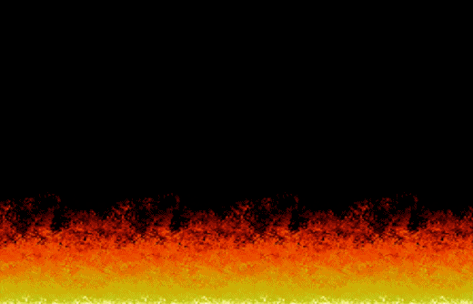
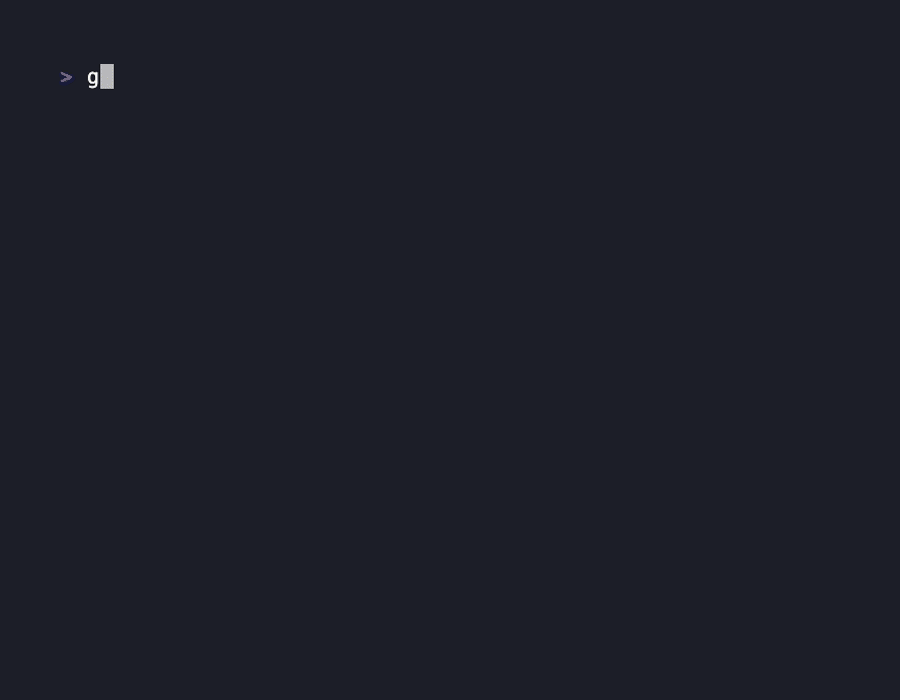

+++
draft = false
title = "Temrinal Toy: Doom Fire Just Got Blockier"
date = "2026-09-10T22:13:44-06:00"
#dateFormat = "2006-01-02"
author = "me"
authorTwitter = "" #do not include @
cover = "demo.gif"
tags = ["Golang", "Terminal","Kata"]
keywords = ["", ""]
description = ""
showFullContent = false
readingTime = false
hideComments = false
+++

It's Doom Fire, but like not good
<!--more-->

Here is the playstation Doom start up screen. 


That's pretty metal. It's popular to remake this animation and supposedly super easy! I love me an easy project. My idea was to give that animation a twist by using ascii graphics. 

Here is how that plan turned out.



Not exactly as metal... but it does have a certain charm no?

Ok if you run my code you won't see the cursor flicker. That's something my terminal recording tool picks up that your naked eye will not see. 

Trust me bro. 

### Install On Mac

```bash
brew install PigsEyedea/tap/gdfire
```

### Run

```bash
gdfire
```

#### Don't have a Mac?
Install from github
https://github.com/PigsEyedea/gdfire/tree/main
