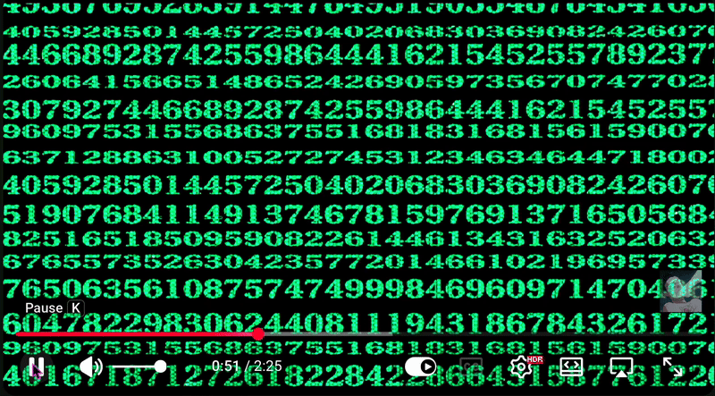
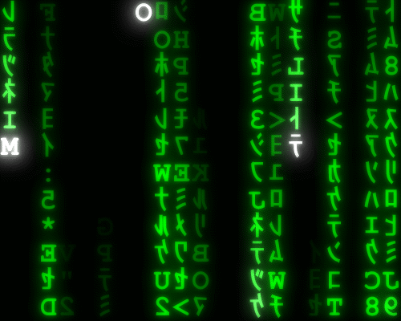
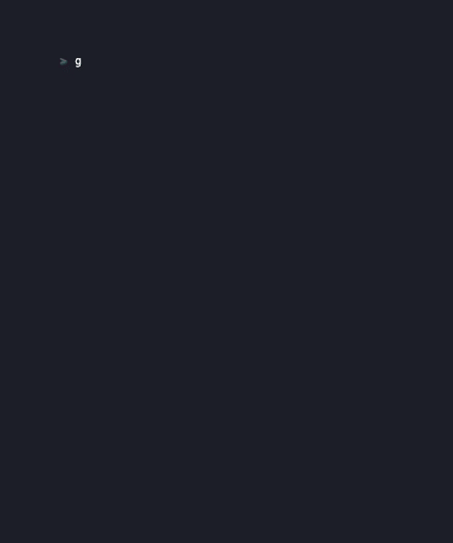
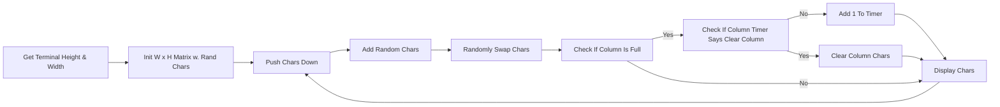

+++
draft = true
title = "Klumsy Terminal Rain"
date = "2026-04-02T22:14:48-06:00"
#dateFormat = "2006-01-02" # This value can be configured for per-post date formatting
author = "me"
authorTwitter = "" #do not include @
cover = "myrain.gif"
tags = ["Golang", "Terminal","Kata"]
keywords = ["", ""]
description = ""
showFullContent = false
readingTime = false
hideComments = false
+++

Digital rain is a toy program implemented by many programmers, something hypnotic that a novice can pull off and feel like a hacker. 
<!--more-->
In the business we call this a kata, a short exercise whose repition hones your skill. The term is on loan from Japanese martial arts because perhaps 70% of programmers are also weebs. 

Fun tangential trivia a weeb like myself would know, the digital rain sequence is inspired by ghost in the shell's opening credits. Goes to show you, anime is a wellspring of culture. 

### Proof![^feet]

[^feet]: Please forgive me for the man with a foot in his mouth :|

I learnt this fun little fact from wikipedia, my source for all facts post college. Wikipedia's digital rain page hosts it's own implementation of the kata. Here the columns fill up with random characters, some of them Japanese, and then wait to gracefully exit. The algo is really that simple... visually.

### Wiki Rain



So, off I go to have an easy time making something cool... 
The novice's prime conceit.


Three hours is generous, this is was my first self directed golang project!



My version's logic is pretty simple. I get the terminal dimensions and make a random matrix based on them, then enter an infinite loop to push the characters down, add characters to columns, randomly swap the characters out, and finally display the characters to the screen. 



Is my version as nice any other version online? No. But my mom was impressed. This is sophisticated enough to impress someone who doesn't know LLMs can code. And that's actually a good kata. Because the exercise is the point, building the muscle memory and skill. Their is no mastery without being cruddy first. 

Given my cruddy code, I am well on my way.

```go

func main() {
	//get the terminal height and width
	width, height, err := term.GetSize(0)
		if err != nil {
			return
		}

	//save the height and width again for some reason
	columns := width
	rows := height
	//make a matrix of random characters based on the terminal height and
	//width
	matrix := makeRandMatrix(rows, columns)

	// Hide the terminal cursor.
	fmt.Print("\033[?25l")
	//make an infinite loop, user will have to press ctrl+c to stop
	for {
		//get the terminal height and width
		widthCheck, heightCheck, err := term.GetSize(0)
		if err != nil {
			return
		}
		//see if the terminal size has changed if true then...
		//restart with a resized matrix
		if widthCheck != width || heightCheck != height {
			width=widthCheck
			height=heightCheck
			rows=height
			columns=width
			matrix = makeRandMatrix(rows,columns)
			
		}
		
		
		// Move to the top-left and clear the screen.
		fmt.Print("\033[H\033[2J")
		//move the chars down and randomly swap the characters out
		bumpMatrix(matrix)
		//show the matrix
		emitMatrix(matrix)
		//pause for a little rest
		time.Sleep(90 * time.Millisecond)
	}
}

```
